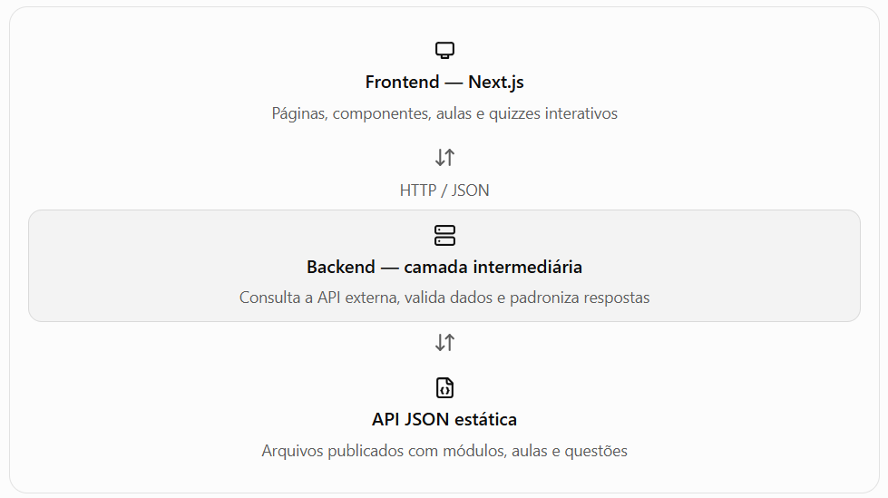

# WebMobile

Projeto educacional Duo Libras, desenvolvido com Next.js.

## Integrantes

- Daniel Yoshio Omiya | 10356170
- Gabriel Jun Ito | 10427610
- Maria Eduarda Pinheiro Leal da Cunha | 10416676
- Rodrigo Nascimento Tomaz | 10418449

## Primeiros passos

Instale as dependências e inicie o servidor de desenvolvimento:

```bash
npm install
npm run dev
# ou
yarn dev
# ou
pnpm dev
# ou
bun dev
```

Abra [http://localhost:3000](http://localhost:3000) no navegador.

Para começar a desenvolver, edite `app/page.js`. A página será atualizada
automaticamente conforme os arquivos forem alterados.

Este projeto usa `next/font` para otimizar automaticamente a fonte Geist,
disponibilizada pela Vercel.

## Arquitetura definida



A API estática fornece os dados, mas não executa regras de negócio nem altera o
conteúdo. O backend é responsável por consultar esses dados e disponibilizá-los
ao Next.js.

## Organização sugerida do projeto

```text
duo-libras/
├── app/
│   ├── layout.js
│   ├── page.js
│   ├── globals.css
│   └── modulos/
│       └── [id]/
│           ├── page.js
│           ├── aulas/
│           │   └── [aulaId]/
│           │       └── page.js
│           └── quizzes/
│               └── [quizId]/
│                   └── page.js
├── components/
│   ├── Header.js
│   ├── ModuleCard.js
│   ├── LessonViewer.js
│   ├── QuizRenderer.js
│   ├── ProgressBar.js
│   └── Lives.js
├── services/
│   └── api.js
├── data/
│   ├── modulos.json
│   └── conteudos/
│       └── alfabeto.json
└── public/
    ├── img/
    │   └── logo.png
    └── media/
        ├── imagens/
        ├── gifs/
        └── videos/
```

## Relação entre o projeto original e a nova arquitetura

| Projeto original | Responsabilidade atual | Adaptação proposta no Next.js |
|---|---|---|
| `index.html` | Documento HTML inicial | `app/layout.js` para a estrutura global e `app/page.js` como página inicial |
| `home.html` | Exibição dos seis módulos temáticos | `app/page.js` e `components/ModuleCard.js`, com os módulos carregados dos dados JSON |
| `modulo.html` | Apresentação das opções de aula e quiz | `app/modulos/[id]/page.js`, exibindo o conteúdo do módulo selecionado |
| `aula.html` | Exibição do conteúdo demonstrativo em mídia | `app/modulos/[id]/aulas/[aulaId]/page.js` e `components/LessonViewer.js` |
| `quiz-selecione-correto1.html` | Quiz de seleção de alternativa | Rota dinâmica de quiz e componente específico de múltipla escolha |
| `quiz-arraste-na-ordem.html` | Ordenação de palavras por arrastar e soltar | Rota dinâmica de quiz e componente de ordenação com estado React |
| `quiz-selecione-correto2.html` | Identificação de um sinal entre opções de mídia | Rota dinâmica de quiz e componente de seleção de vídeo ou imagem |
| `quiz-arraste-aqui.html` | Associação de textos com vídeos | Rota dinâmica de quiz e componente de associação entre texto e mídia |
| `js/modulo.js` | Script associado à tela de módulo | Lógica React da página de módulo, após análise das funções existentes |
| `js/quiz-elementos.js` | Elementos e funções compartilhados pelos quizzes | `components/Lives.js`, `components/ProgressBar.js` e lógica compartilhada |
| `js/quiz-selecione-correto1.js` | Interação da primeira seleção | Lógica específica do quiz de múltipla escolha |
| `js/quiz-selecione-correto2.js` | Interação da seleção de vídeos | Lógica específica de seleção de mídia |
| `js/quiz-arraste-na-ordem.js` | Eventos de arrastar e soltar palavras | Estado React e lógica de ordenação das opções |
| `js/quiz-arraste-aqui.js` | Eventos de associação por arrastar e soltar | Estado React e lógica de associação entre textos e vídeos |
| `conteudo.json` | Dados do módulo Alfabeto e respostas dos quizzes | `data/conteudos/alfabeto.json` ou arquivo JSON disponibilizado pela API estática |
| `style.css` | Estilos principais das páginas | `app/globals.css` e, se necessário, CSS Modules por componente |
| `img/logo.png` | Logotipo do Duo Libras | `public/img/logo.png` |
| Referências de mídia em HTML e JSON | GIFs e vídeos demonstrativos | Centralizar os caminhos em dados JSON e organizar os arquivos em `public/media/` ou em hospedagem externa |

## Contrato da API

O backend deve oferecer endpoints consistentes, mesmo que os dados de origem
estejam em arquivos estáticos.

| Método e endpoint proposto | Fonte JSON | Resultado esperado |
|---|---|---|
| `GET /api/modulos` | `modulos.json` | Lista de módulos |
| `GET /api/modulos/:id` | Dados do módulo | Detalhes de um módulo |
| `GET /api/modulos/:id/aulas` | Conteúdo do módulo | Lista de aulas |
| `GET /api/quizzes/:id` | Dados do quiz | Questões e configurações da atividade |

O backend deverá converter os identificadores recebidos nas requisições para os
arquivos ou recursos correspondentes, validar os dados e devolver respostas JSON.
Um identificador inexistente deverá resultar em uma resposta de não encontrado,
em vez de um erro inesperado.

## Saiba mais

- [Documentação do Next.js](https://nextjs.org/docs)
- [Aprenda Next.js](https://nextjs.org/learn)
- [Repositório do Next.js no GitHub](https://github.com/vercel/next.js)

## Implantação

A maneira mais simples de implantar o projeto é usar a [Vercel](https://vercel.com/new).
Consulte também a [documentação de implantação do Next.js](https://nextjs.org/docs/app/building-your-application/deploying).
